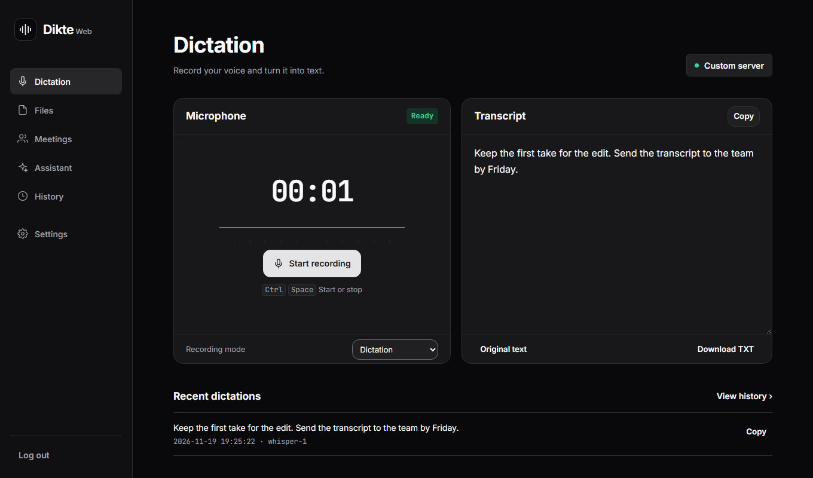
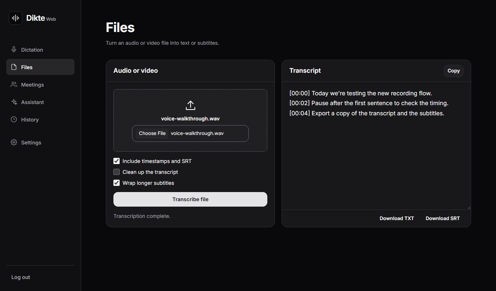
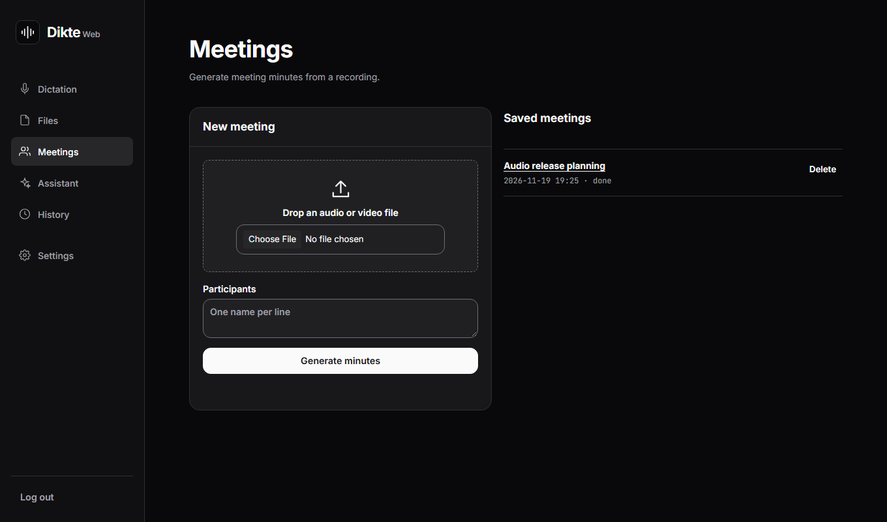
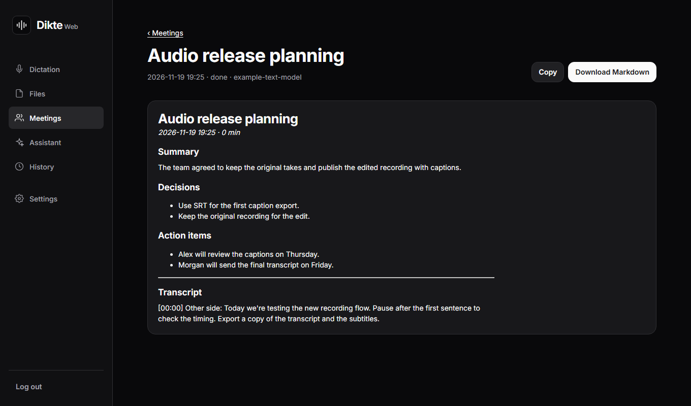
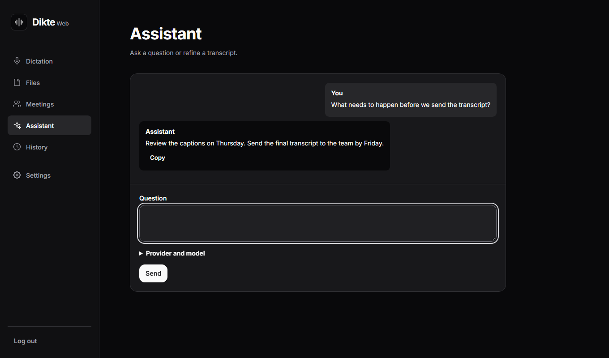
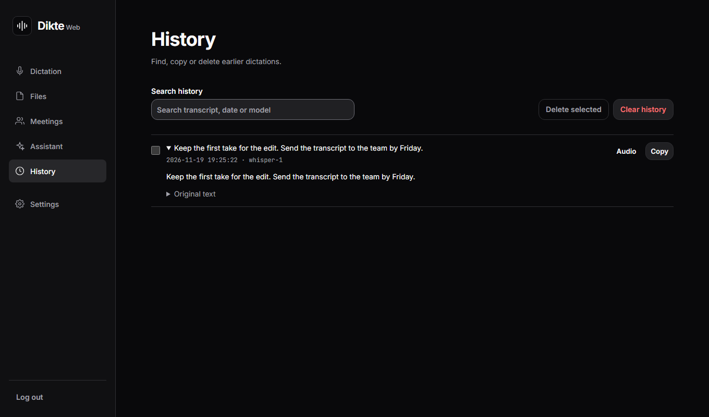
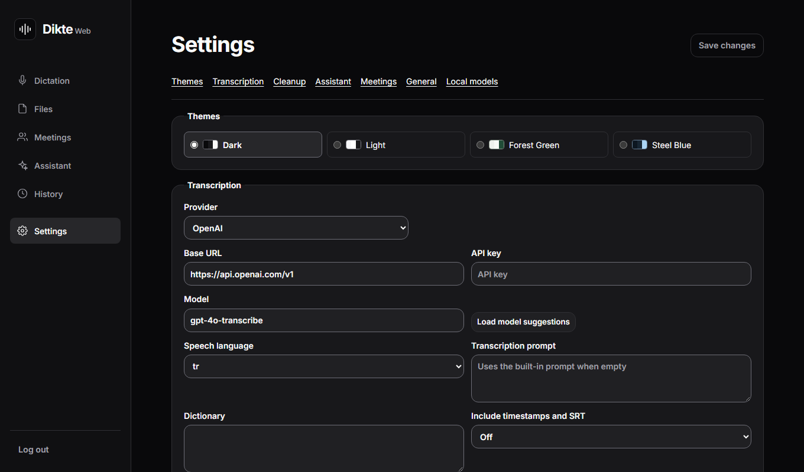
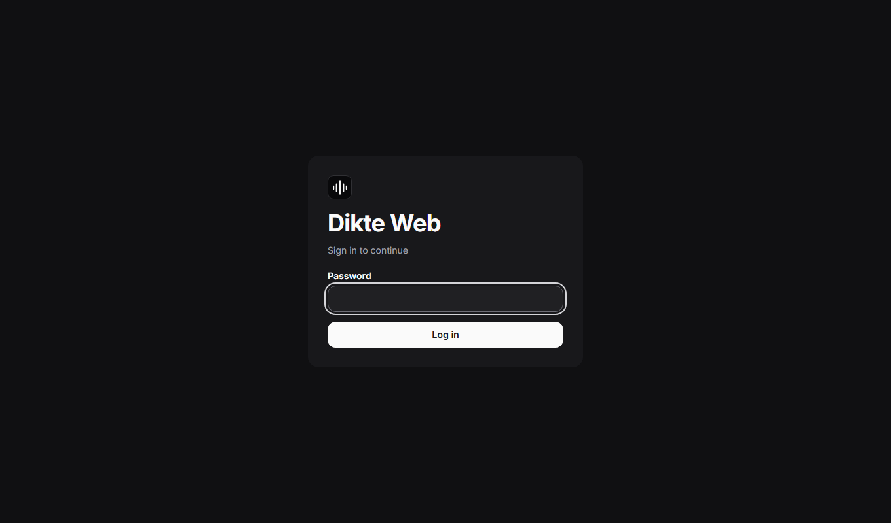
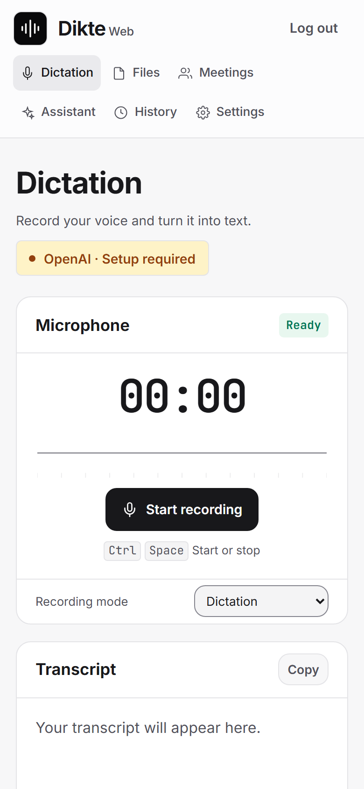

# Dictation Web

[English](README.md) · [Son sürüm](https://github.com/eco-null/dictation-web/releases/latest) · [Docker kurulumu](#docker-ile-çalıştırma) · [Ekran görüntüleri](#ekran-görüntüleri)

[Yusuf İpek’in Dikte projesini](https://github.com/yusufipk/dikte) kendi sunucunuzda çalıştırabileceğiniz tek kullanıcılı bir web uygulamasına uyarladım. Tarayıcıdan ses kaydedin, ses veya video dosyasını yazıya çevirin ya da toplantı kaydından Markdown tutanak oluşturun.

[](docs/screenshots/dictation.webp)

## Özellikler

- **Dikte** ekranında mikrofonu kaydedebilir, duraklatıp devam ettirebilir, süreyi ve ses dalgasını görebilirsiniz. Ekran odaktayken Ctrl+Space kaydı başlatır veya bitirir. Sonucu kopyalayabilir, ham metinle karşılaştırabilir veya TXT olarak indirebilirsiniz.
- **Yazım** için özel adları ve terimleri sözlüğe ekleyin. Ayarlar → Temizleme bölümünde yazım talimatlarını ve isteğe bağlı çeviri dilini seçin.
- **Dosyalar** ses ve video yükler, TXT ve SRT üretir. Metin düzenleme ve uzun altyazı satırlarını kelime sınırlarından bölme seçenekleri vardır.
- **Toplantılar** zaman damgalı transkript ve Markdown tutanak üretir. Stereo kayıtta sol kanal mikrofonunuz, sağ kanal karşı taraftır. Mono kayıtta tek konuşmacı etiketi kullanılır. Özet başarısız olursa tekrar deneme saklanan transkripti kullanır.
- **Asistan** yazılı soruları veya Dikte ekranından gönderilen sesli soruları yanıtlar. Konuşmayı ayarlanan süre boyunca hatırlar. Bir istek için bulut modelini ayrıca seçebilirsiniz.
- **Geçmiş** tam transkripti, tarihi ve modeli arar. Ses saklama açıksa geçmişten ses kaydı da indirilir. Geçmiş girdisi silindiğinde veya sınır nedeniyle budandığında ilgili ses kaydı kaldırılır.

Arayüz Türkçe ve İngilizce kullanılabilir. **Ayarlar → Temalar** bölümünde Koyu, Açık, Orman Yeşili ve Çelik Mavi seçenekleri var. Seçim anında görünür ve kaydedildiğinde korunur.

## Docker ile çalıştırma

Yeni kurulum için son sürümden [compose.yaml](https://github.com/eco-null/dictation-web/releases/latest/download/compose.yaml) dosyasını indirin. Yanında bir `.env` dosyası oluşturup kendi parolanızı ve ayarları, geçmişi ve modelleri saklayacak birim adını yazın.

```dotenv
DIKTE_WEB_PASSWORD=kendi-parolanizi-yazin
DIKTE_COOKIE_SECURE=0
DIKTE_DATA_DIR=dikte_data
```

```sh
docker compose up -d
```

<http://localhost:8245> adresini açın. HTTPS kullanırken `DIKTE_COOKIE_SECURE=1` bırakın. Uygulamayı HTTPS üzerinden sunmak için ters proxy veya Cloudflare Tunnel kullanabilirsiniz. Tarayıcıda mikrofon erişimi HTTPS veya localhost gerektirir.

Sürümden indirilen dosya, ilgili imaj sürümünü sabitler. Depodaki `docker-compose.yml` ise `ghcr.io/eco-null/dictation-web:latest` etiketini takip eder. İmajı elle seçmek için `DIKTE_IMAGE` değerini ayarlayın.

Mevcut kurulumu güncellerken veri bağını ve Compose proje adını koruyun. `DIKTE_DATA_DIR` boşsa eski kurulum yolu `/DATA/AppData/dikte-web` kullanılır. Farklı bir ana makine dizini seçerseniz önce kapsayıcıdaki `dikte` kullanıcısına yazma izni verin. Varsayılan 8245 portu loopback adresine bağlıdır. Adresi veya portu `DIKTE_BIND_ADDRESS` ve `DIKTE_PORT` ile değiştirebilirsiniz. Kendi parolanızı girin veya kapsayıcıdaki `/data/share/dikte/web_password` dosyasından üretilen parolayı okuyun.

## Kaynaktan çalıştırma

Python 3.11+ ve PATH üzerinde FFmpeg gerekir.

```sh
python -m pip install -r requirements.txt
python -m uvicorn app.main:app --host 127.0.0.1 --port 8000
```

Yerel HTTP geliştirmesinde kabukta `DIKTE_COOKIE_SECURE=0` ayarlayın. `DIKTE_WEB_PASSWORD` boşsa uygulama ürettiği parolayı veri dizininde `web_password` dosyasına kaydeder. Arka plan işleri ve oturum imzalama tek sunucu sürecinde çalışır.

## Sağlayıcılar ve modeller

Transkripsiyon, düzenleme, asistan ve toplantı transkripsiyonu için ayrı sağlayıcı ve model seçebilirsiniz. OpenAI, Groq, OpenRouter, OmniRoute ve özel OpenAI uyumlu sunucu seçenekleri bulunur. Özel sunucu anahtarsız çalışabilir. Sunucunun transkripsiyon için `/audio/transcriptions`, metin işlemleri için `/chat/completions` uçlarını desteklemesi gerekir. SRT ve toplantı zaman çizelgesi, transkripsiyon sağlayıcısının zaman damgası üretmesine bağlıdır. Toplantı özeti düzenleme sağlayıcısını kullanır. OpenRouter için ayrı bir özet modeli seçebilirsiniz.

Ses için whisper.cpp, metin için llama.cpp kullanmak üzere **Yerel** seçeneğini seçin. Ayarlar → Yerel modeller uyumlu model ve programları sağlama toplamını denetleyerek indirir. Uyumlu paket bulunmayan makinelerde `whisper-server` veya `llama-server` kurup PATH’e ekleyin. Anahtarları Ayarlar’da kaydedin. Model önerileri kayıtlı adres ve anahtarla alınır. Model kimliğini elle de girebilirsiniz.

## Veri ve API

| Ayar | İşlevi |
| --- | --- |
| `DIKTE_WEB_PASSWORD` | Tek giriş parolası |
| `DIKTE_COOKIE_SECURE` | Yalnız HTTPS oturum çerezi, varsayılan `1` |
| `DIKTE_MAX_UPLOAD` | Bayt olarak dosya boyutu sınırı, varsayılan 1 GiB |
| `XDG_CONFIG_HOME` | `dikte/config.json` dosyasının kök dizini |
| `XDG_DATA_HOME` | Geçmiş, toplantılar, modeller ve üretilen parola için kök dizin |

Docker’da ayarlar `/data/config`, diğer veriler `/data/share` altında tutulur. İkisini de korumak için bağlı dizini yedekleyin. Bu dizin API anahtarlarını, transkriptleri ve ses kayıtlarını içerebilir.

- `POST /api/dictate`, `POST /api/files/transcribe` ve `POST /api/meetings`, multipart dosya yüklemesi alıp iş kimliği döndürür.
- `GET /api/jobs/{id}` durumu ve sonucu gösterir. `GET /api/jobs/{id}/download?fmt=txt|srt` ilgili çıktıyı indirir. Aynı anda bir ağır iş çalışabilir. Dolu kuyruk HTTP 409 döndürür.
- `GET /api/meetings/{base}/download` tutanağı indirir. `POST /api/meetings/{base}/retry` tekrar dener.
- `POST /api/agent`, `question` ve isteğe bağlı `provider` ile `model` alanlarını alır. `GET /api/history` dikteleri listeler. `GET /api/settings` anahtarları maskeler ve `POST /api/settings` değişen alanları kabul eder.
- `GET /healthz` herkese açıktır. Diğer API uçları imzalı oturum çerezi gerektirir.

## Ekran görüntüleri

Galeride İngilizce arayüz ve örnek kayıtlar yer alıyor. Görüntüleri tam boy açmak için üzerlerine tıklayın.

| Dosya transkripsiyonu | Toplantılar |
| --- | --- |
| [](docs/screenshots/files.webp) | [](docs/screenshots/meetings.webp) |

| Toplantı tutanağı | Asistan |
| --- | --- |
| [](docs/screenshots/meeting-notes.webp) | [](docs/screenshots/assistant.webp) |

| Geçmiş | Ayarlar |
| --- | --- |
| [](docs/screenshots/history.webp) | [](docs/screenshots/settings.webp) |

| Giriş | Mobil dikte ve Açık tema |
| --- | --- |
| [](docs/screenshots/sign-in.webp) | <a href="docs/screenshots/dictation-mobile.webp"></a> |

## Geliştirme ve orijinal proje

```sh
python -m pip install -r requirements-dev.txt
python -m pytest
```

Bu güncelleme altyazı satır bölme, kelime zamanlamalı altyazı ve kısa kayıtlardaki halüsinasyon filtresi için orijinal deponun [`ab35e01`](https://github.com/yusufipk/dikte/commit/ab35e01a6eaaa4933b2478f7a3c5760d7eb7c90c) revizyonunu temel alır. Sözlük, yazım talimatları, çeviri, kayıt kontrolleri ve sesli sorular tarayıcıya uyarlanmıştır. Sistem genelinde kısayol, diğer uygulamalara otomatik yapıştırma, sistem sesi kaydı ve masaüstü CLI entegrasyonları yerel uygulama gerektirir.

Lisans [GPL-3.0](LICENSE).
